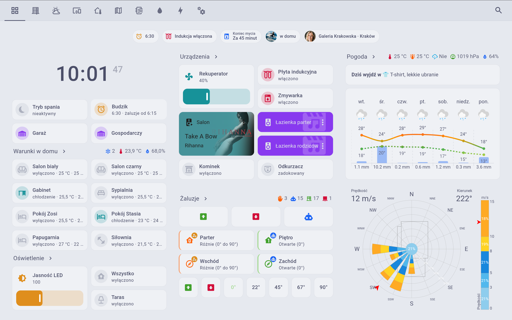

  <picture>
    <source media="(prefers-color-scheme: dark)" srcset="custom_components/onesmarthome/brand/dark_logo@2x.png">
    
  </picture>

  <b>Natywna integracja sterowników Grenton z Home Assistant - lokalnie, bez chmury.</b>

  <a href="https://onesmarthome.pl">🌐 onesmarthome.pl</a>
  &nbsp;·&nbsp;
  <a href="mailto:kontakt@onesmarthome.pl">✉️ kontakt@onesmarthome.pl</a>

  
  
  
  
  

  

# OneSmartHome

Integracja **Home Assistant ↔ Grenton** - łączy sterownik Grenton (CLU) z Home
Assistant lokalnie po TCP i wystawia obiekty Grentona jako natywne encje HA
(światła, przełączniki, sensory, rolety, liczby, przyciski, kamery).

> Darmowa, otwarta wtyczka (licencja MIT). Bez chmury, bez kont, bez naszego
> udziału - komunikacja odbywa się wyłącznie w Twojej sieci lokalnej.

---

## Co robi

- Pobiera definicję interfejsu myGrenton bezpośrednio ze sterownika (port `9998`).
- Mapuje obsługiwane widgety na encje Home Assistant.
- Utrzymuje stan encji na bieżąco przez lokalną komunikację z CLU (`local_push`).
- Działa w pełni lokalnie - dom nie potrzebuje internetu ani zewnętrznego serwera.

### Obsługiwane obiekty Grenton

Wtyczka rozpoznaje poniższe typy obiektów/widgetów Grenton i mapuje je na
natywne encje Home Assistant:

| Obiekt Grenton | Encja Home Assistant |
|---|---|
| Przełącznik (ON/OFF, jedno- i dwukanałowy) | `switch` |
| Ściemniacz (DIMMER) | `light` (jasność) |
| Sterownik LED (RGBW) | `light` (kolor + biel) |
| Roleta (v3) | `cover` (pozycja + nachylenie lameli, stop) |
| Roleta (starszy typ) | `sensor` stanu + `button` |
| Suwak | `number` (+ `button`, jeśli ma akcję) |
| Scena (jedno- i dwukanałowa) | `button` |
| Sensor / wejście kontaktowe (jedno- i dwukanałowy) | `binary_sensor` (+ `button`) |
| Wartość (v2 i podwójna) | `sensor` |
| Multisensor | 7× `sensor`: CO₂, hałas, LZO, natężenie światła, ciśnienie, wilgotność, temperatura |
| Kamera IP | `camera` |

Docelowo wszystko trafia do ośmiu platform HA: `light`, `switch`, `sensor`,
`binary_sensor`, `cover`, `number`, `button`, `camera`.

## Wymagania

- Home Assistant **2026.6** lub nowszy.
- Sterownik Grenton (CLU) osiągalny w tej samej sieci lokalnej co Home Assistant.
- Token dostępu do interfejsu (ten sam, którego używa aplikacja myGrenton do
  pobrania konfiguracji). Jeśli instalację konfigurował instalator, token
  otrzymasz od niego. Znajdziesz go też w Grenton Object Managerze.

## Instalacja

### Wariant A - HACS (zalecany)

1. HACS → menu (⋮) → **Custom repositories**.
2. Wklej `https://github.com/one-smarthome/onesmarthome-ha`, kategoria
   **Integration**, i dodaj.
3. Zainstaluj **OneSmartHome** z listy w HACS.
4. Zrestartuj Home Assistant.

### Wariant B - ręcznie

1. Pobierz repozytorium (Code → Download ZIP lub `git clone`).
2. Skopiuj katalog `custom_components/onesmarthome` do
   `config/custom_components/` w swojej instalacji Home Assistant. Docelowo
   ścieżka to `config/custom_components/onesmarthome/manifest.json`.
3. Zrestartuj Home Assistant.

## Konfiguracja

Po restarcie:

**Ustawienia → Urządzenia i usługi → Dodaj integrację → OneSmartHome**

Podaj:

| Pole | Opis |
|------|------|
| **Adres IP centrali** | Lokalny adres IP sterownika CLU, np. `192.168.100.15`. |
| **Token** | Token autoryzujący pobranie konfiguracji interfejsu; zostaje zapisany lokalnie w Home Assistant. |

Integracja pobierze konfigurację interfejsu, utworzy obsługiwane encje i zacznie
synchronizować ich stan. Ponowne pobranie interfejsu (po zmianach w Grentonie)
zrobisz przez **Skonfiguruj ponownie** na wpisie integracji - encje, których już
nie ma, zostaną usunięte, a nowe dodane.

## Wsparcie

To projekt **darmowy i udostępniany bez indywidualnego wsparcia**. Pomoc odbywa
się w modelu społecznościowym:

- Błędy i pytania → [GitHub Issues](https://github.com/one-smarthome/onesmarthome-ha/issues).
- Kod jest otwarty - poprawkę (Pull Request) może zgłosić każdy, łącznie z Tobą.

### Wolisz gotowy dom zamiast majsterkowania?

Robimy pełne wdrożenia Home Assistant na sterownikach Grenton — pod klucz:

- dopracowane dashboardy i panel naścienny,
- autorska automatyka żaluzji słońce/wiatr liczona na CLU,
- konfiguracja, testy i opieka powdrożeniowa.

> **[→ Zobacz ofertę i porównanie „sam czy z nami" na onesmarthome.pl](https://onesmarthome.pl/sam-czy-z-nami)**
>
> Pytania? Napisz na **[kontakt@onesmarthome.pl](mailto:kontakt@onesmarthome.pl)**.

## Zastrzeżenia

Projekt niezależny. Nie jesteśmy powiązani, autoryzowani ani sponsorowani przez
Grenton sp. z o.o. ani Open Home Foundation / Nabu Casa. „Grenton" jest znakiem
towarowym Grenton sp. z o.o., „Home Assistant" - znakiem towarowym Open Home
Foundation / Nabu Casa; nazwy te użyte są wyłącznie opisowo, w celu wskazania
kompatybilności.

## Licencja

[MIT](LICENSE) © 2026 Jacek Marchewka One.
